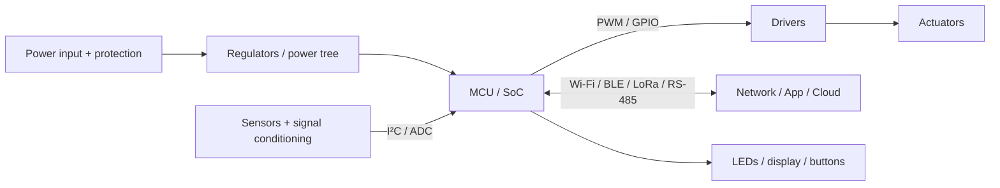

# Hardware Blueprint — <project>

_Hardware Engineering kit · <date> · target stage: prototype | PCB v1 | production_

## 1. Summary
- **What it does**:
- **Architecture in one sentence**:
- **Key parts**: MCU/SoC, sensors, actuators, comms, power
- **Estimated BOM**: $x @ 1 unit / $y @ 1k units (+ PCB/assembly/enclosure estimates)
- **Power**: source, average current, battery life
- **Biggest risk & mitigation**:
- **First build step**:

## 2. Requirements (traceability)
| Req ID | Requirement | Design element | Verification (test ID) |
|---|---|---|---|
→ [REQUIREMENTS.md](REQUIREMENTS.md)

## 3. System architecture

Subsystem table (role, placement, interfaces, parts). Data-flow & protocol table. → [ARCHITECTURE.md](ARCHITECTURE.md)

## 4. Components & selection rationale
| Role | Selected | Alternatives compared | Why selected | Second source |
|---|---|---|---|---|
→ [COMPONENTS.md](COMPONENTS.md), TRADE_*.md

## 5. Electrical design
Connection table, protection circuits, circuit explanations with calculator results, wiring diagram. → [ELECTRICAL.md](ELECTRICAL.md)

## 6. Pin map
→ [PINMAP.md](PINMAP.md) (checked with pins.mjs)

## 7. Power architecture
Power tree, regulator choices, budget, battery life, thermal. → [POWER_BUDGET.md](POWER_BUDGET.md)

## 8. PCB & mechanical
Stackup, placement zones, critical routing, EMC measures, connectors, enclosure, DFM. → [PCB.md](PCB.md)

## 9. Firmware
Architecture, state machine, tasks/timing, drivers, fault handling, OTA, toolchain, build/flash/test commands. → [FIRMWARE.md](FIRMWARE.md), `firmware/`

## 10. Test, calibration & safety
Test plan summary, calibration procedure, safety mechanisms. → [TEST_PLAN.md](TEST_PLAN.md)

## 11. Failure modes
Top FMEA items and how hardware + firmware handle them. → [FMEA.md](FMEA.md)

## 12. BOM & cost
Per-unit cost at 1 / 100 / 1000, plus PCB, assembly, enclosure, test, certification estimates. → [BOM.md](BOM.md)

## 13. Implementation guide (step by step)
### Stage A: dev-board prototype
1. Buy: … (dev boards/breakouts list with links)
2. Wire per connection table; power from a current-limited supply
3. Flash firmware (commands); run bring-up tests; calibrate
4. Measure current profile; validate against the power budget
### Stage B: custom PCB v1
1. Schematic in KiCad from ELECTRICAL.md; layout per PCB.md
2. Order boards (fab notes); assemble; bring-up per TEST_PLAN
3. Environmental + EMC pre-scan; fix issues → v1.1
### Stage C: production readiness
DFM/DFA review, certification plan, production test fixture, supply-chain (second sources, buffers), documentation.

## 14. Optimisation opportunities
| Axis | Change | Benefit | Trade-off | When worth it |
|---|---|---|---|---|
| Cheaper | | | | |
| Smaller | | | | |
| Lower power | | | | |
| More reliable | | | | |
| Faster / more capable | | | | |
| Scalable | | | | |
| Innovative | | | | |

## 15. Assumptions, risks & open questions
## 16. Sources
Datasheets (with revision), app notes, reference designs, research, distributor data (with date).
